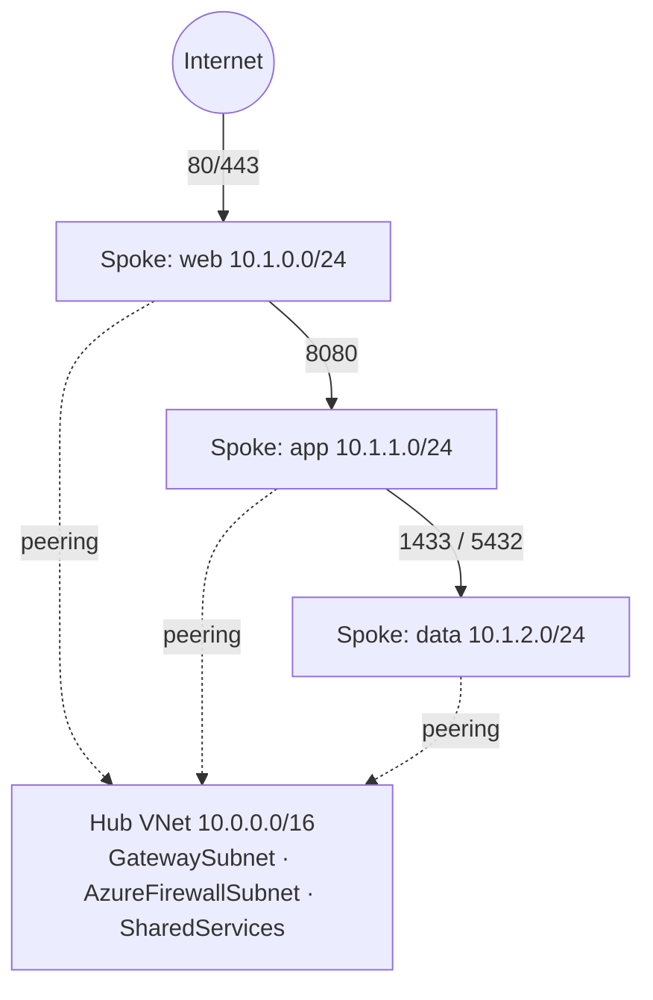

# Azure VNet — Hub-Spoke Network (Terraform)

A hub-spoke Azure network built with Terraform, written as a portfolio piece
for network engineering: segmented tiers, least-privilege NSGs, and peering —
no paid firewall or gateway required to deploy it.

## Architecture



| VNet | CIDR | Subnets |
| --- | --- | --- |
| `vnet-hub` | 10.0.0.0/16 | GatewaySubnet 10.0.0.0/24, AzureFirewallSubnet 10.0.1.0/24, SharedServices 10.0.2.0/24 |
| `vnet-spoke` | 10.1.0.0/16 | web 10.1.0.0/24, app 10.1.1.0/24, data 10.1.2.0/24 |

## What it builds

- **Hub and spoke VNets** with bidirectional peering (forwarded traffic
  allowed, gateway transit off — no gateway is deployed).
- **Tiered NSGs:** web accepts 80/443 from the internet; app accepts 8080
  only from the web subnet; data accepts 1433/5432 only from the app subnet.
  Admin SSH/RDP to SharedServices is allowed only from a single source IP
  you set — and no rule is created at all if you leave it empty.
- **Route table** on the spoke subnets, ready for a hub firewall: set
  `firewall_private_ip` and spoke egress gets a `0.0.0.0/0` route via it.
- **Optional NAT Gateway** (`enable_nat_gateway`) for outbound-only
  internet from the spoke subnets.

## Cost notes

With defaults, this deploys only VNets, subnets, NSGs, peering, and a route
table — all free or near-free. The expensive parts are deliberately
optional or absent: Azure Firewall (~$1,000/mo) is not deployed, and the
NAT Gateway (~$32/mo) is off by default. Remember to `terraform destroy`
when you are done with a lab.

## Usage

```bash
az login
terraform init
terraform plan
terraform apply
```

Copy `terraform.tfvars.example` to `terraform.tfvars` to set your region,
admin source IP, and optional features. Requires Terraform >= 1.5 and the
`azurerm` provider (~> 4.0, pinned in `versions.tf`).

## Files

| File | Purpose |
| --- | --- |
| `main.tf` | Resource group, hub/spoke VNets, peering |
| `network.tf` | Subnets, NSGs, route table, optional NAT Gateway |
| `variables.tf` | All inputs, with defaults and descriptions |
| `outputs.tf` | VNet, subnet, and NSG IDs for downstream modules |
| `versions.tf` | Terraform and provider version pins |
| `terraform.tfvars.example` | Example inputs (copy to `terraform.tfvars`) |

## Design decisions

- **Hub-spoke over a single VNet:** keeps shared services (gateway,
  firewall, DNS) in one place and lets each workload live in its own
  spoke — the pattern most enterprise Azure estates use.
- **Subnets as maps with `for_each`:** adding a tier is one line in
  `variables.tf`, not a new resource block.
- **NSGs deny by default:** every allow rule names its source tier, so a
  compromised web VM cannot reach the data tier directly.
- **No firewall by default:** the UDR path is wired up, but the $1k/mo
  appliance is a decision, not a side effect of `terraform apply`.
